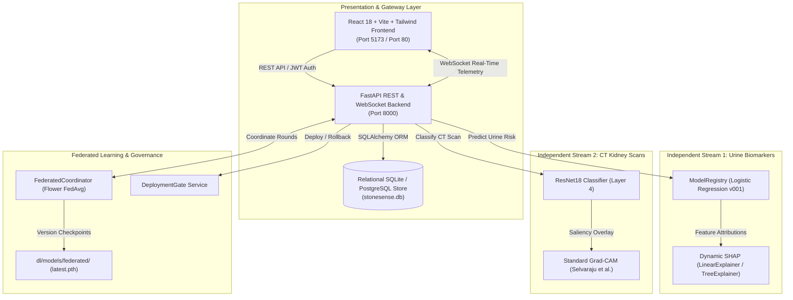

# StoneSense-AI

[](https://github.com/akhilan77/StoneSense-AI/actions/workflows/ci.yml)
[](https://fastapi.tiangolo.com)
[](https://react.dev)
[](https://www.typescriptlang.org)
[](https://pytorch.org)
[](https://flower.ai)

> [!CAUTION]
> ### ⚠️ RESEARCH PROTOTYPE DISCLAIMER — NOT FOR CLINICAL USE
> **StoneSense-AI is an experimental academic research prototype and proof-of-concept software system.**  
> It has **NOT** undergone prospective clinical validation, clinical trials, or regulatory certification (FDA 510(k), CE-IVD, CDSCO, or HIPAA/GDPR clinical clearance).  
> **IT MUST NOT BE USED FOR PRIMARY CLINICAL DIAGNOSIS, PATIENT TRIAGE, SURGICAL PLANNING, OR CLINICAL TREATMENT DECISIONS.**

> [!IMPORTANT]
> ### 📊 CRITICAL DATASET LIMITATIONS & GENERALIZATION NOTICE
> 1. **Urine Biochemistry (Tabular) Cohort**: Trained on a historical dataset of **79 unique patient observations** (cleaned from the 80-row Andrews & Lyne bench test cohort). Due to this small sample size, metrics carry broad confidence intervals ($95\%\text{ CI: }[0.7327, 0.9176]$ for Logistic Regression ROC-AUC).
> 2. **CT Scan Slices**: Derived from a public Kaggle dataset containing 12,446 axial CT slice images across 4 classes (`Cyst`, `Normal`, `Stone`, `Tumor`). The original dataset **does not provide patient or volume identifiers**. To prevent near-duplicate slice leakage, splits were grouped using perceptual hashing ($pHash \le 2$ Hamming distance connected components, yielding 979 cluster units). True patient-level isolation across different hospital systems remains **unverified** without raw DICOM metadata.

---

## Executive Overview

StoneSense-AI is a multi-modal Explainable AI (XAI) decision-support platform designed to assist research urologists in evaluating kidney stone risk and axial CT imaging. It provides two independent, decoupled evidence streams:
1. **Biomarker Risk Analysis**: Evaluates 6 routine urine biochemistry parameters (`gravity`, `ph`, `osmo`, `cond`, `urea`, `calc`) using statistical risk models (Logistic Regression baseline, Random Forest, XGBoost) explained via **SHAP** feature attributions.
2. **Axial CT Kidney Slices**: Classifies CT slices using transfer-learning convolutional networks (**ResNet18**), visualized via **Grad-CAM** saliency overlays.
3. **Decentralized Federated Learning**: Simulates multi-hospital collaborative training using the **Flower (flwr)** framework, synchronizing model weights without centralizing raw hospital scan files.



---

## Verified Project Status

| Component | Status | Verified Reality & Code Evidence |
| :--- | :---: | :--- |
| **Tabular Risk Pipeline** | **DONE** | 50-fold nested repeated stratified CV implemented in [`ml/training/train_risk_model.py`](ml/training/train_risk_model.py). Model registry in [`ml/risk_models/registry.py`](ml/risk_models/registry.py) active with `logistic_regression_v001` (1-SE winner) and `xgboost_v001`. |
| **SHAP Explainability** | **DONE** | Dynamic explainer (`LinearExplainer` for linear models, `TreeExplainer` for tree models) implemented in [`ml/explainability/shap_explainer.py`](ml/explainability/shap_explainer.py) and [`backend/app/services/explainability_service.py`](backend/app/services/explainability_service.py). Top features and directions returned via API. |
| **CT ResNet18 Classifier** | **DONE** | PyTorch ResNet18 transfer learning pipeline in [`dl/training/train_resnet18.py`](dl/training/train_resnet18.py); audited grouped benchmark in [`dl/training/train_resnet18_audit.py`](dl/training/train_resnet18_audit.py). Weights loaded in backend [`backend/app/services/model_loader.py`](backend/app/services/model_loader.py). |
| **Grad-CAM Saliency Maps** | **DONE** | Standard Grad-CAM (Selvaraju et al., 2017) targeting `layer4[-1]` implemented in [`dl/explainability/gradcam.py`](dl/explainability/gradcam.py), [`backend/app/services/explainability_service.py`](backend/app/services/explainability_service.py), and [`dl/models/wrappers/resnet18_wrapper.py`](dl/models/wrappers/resnet18_wrapper.py). All UI labels and documentation normalized to Grad-CAM. |
| **Multi-Model DL Wrappers** | **PARTIAL** | Wrappers implemented in [`dl/models/wrappers/`](dl/models/wrappers/) for YOLO26 (`best.pt`), DINOv3 (feature backbone), and QKNN (quantum simulator). YOLO26 and DINOv3 run inference; QKNN is an experimental low-accuracy prototype (41.95% acc). |
| **Federated Learning (Core A1–A8)** | **DONE** | Local training refactor (`train_local`), dataset partitioning (IID/non-IID), Flower `NumPyClient`, Flower server + `StoneSenseFedAvg`, versioned checkpoints (`resnet18_fed_round_001.pth`–`029.pth`), DB telemetry persistence, and multi-hospital simulation runner in [`dl/federated/`](dl/federated/). Real per-client training confirmed. |
| **Federated UI & APIs (B1–B5)** | **DONE** | 52 REST endpoints registered in FastAPI; Hospital FL UI ([`HospitalFederatedLearning.tsx`](frontend/src/pages/HospitalFederatedLearning.tsx)) and Developer FL Console ([`DeveloperDashboard.tsx`](frontend/src/pages/DeveloperDashboard.tsx)) connected via [`federatedApi.ts`](frontend/src/services/federatedApi.ts) and WebSockets. |
| **Rule-Based Evidence Concordance** | **DONE** | Implemented in [`backend/app/services/concordance_service.py`](backend/app/services/concordance_service.py) (`POST /api/v1/predict/concordance`). Accepts server-stored prediction IDs (`risk_prediction_id`, `image_prediction_id`), strictly enforcing hospital tenant and patient scoping. Uses `CONCORDANT_NO_STONE_EVIDENCE` ("No stone evidence in either stream") with real verified CT stone recall (65.70%) and small tabular dataset citations. |
| **Image Upload Validation & OOD Gate** | **DONE** | Implemented in [`backend/app/utils/image_utils.py`](backend/app/utils/image_utils.py) and `/api/v1/predict/image`. Enforces bounded 10 MB payload limits (HTTP 413), content-based magic bytes verification (PNG/JPEG only, HTTP 415), scoped Pillow decompression-bomb rejection at 1x MAX_IMAGE_PIXELS (HTTP 413), degenerate dimension & aspect ratio checks, and model-level OOD/uncertainty gate. |
| **Authentication & RBAC** | **DONE** | JWT access/refresh tokens with bcrypt password hashing; role-based access control (`hospital_user`, `developer`, `admin`) and hospital scoping enforced in [`backend/app/core/auth.py`](backend/app/core/auth.py). Audit logging to database records all administrative and clinical actions without logging PII. |
| **Patient Record Encryption (PII)** | **DONE** | Implemented in [`backend/app/core/pii_crypto.py`](backend/app/core/pii_crypto.py) and [`backend/app/db/pii_types.py`](backend/app/db/pii_types.py). Authenticated AES-256-GCM column encryption with fresh 96-bit nonces for `name`, `phone`, `email` in SQLite/PostgreSQL. Keyed HMAC-SHA256 blind indexing for exact-match search without exposing plaintext. Idempotent migration backfill and fail-closed key management. |
| **Infrastructure & CI** | **DONE** | Pinned dependencies in [`requirements.txt`](requirements.txt), Docker Compose ([`docker-compose.yml`](docker-compose.yml)), Nginx proxy config (`client_max_body_size 10M`), Alembic migrations, and GitHub Actions CI ([`.github/workflows/ci.yml`](.github/workflows/ci.yml)). |

---

## Verified Evaluation Metrics

All metrics reported below are backed by verified evaluation files committed on disk. Historical unverified or leaky metrics are explicitly flagged.

### 1. Tabular Risk Models (50-Fold Repeated Stratified Nested CV)
*Backing file:* [`ml/models/comparison_results.csv`](ml/models/comparison_results.csv) & [`ml/models/registry_manifest.json`](ml/models/registry_manifest.json)  
*Validation Protocol:* 5 folds $\times$ 10 repeats (50 total cross-validation folds) with row-level bootstrap (1,000 iterations) and 1,000-iteration permutation significance testing.

| Model | Complexity Rank | Mean ROC-AUC (95% CI) | Mean Macro F1 (95% CI) | Mean Accuracy (95% CI) | Mean MCC | Permutation $p$-value | Deployed Status |
| :--- | :---: | :---: | :---: | :---: | :---: | :---: | :---: |
| **Logistic Regression** | **1 (Simplest)** | **0.8387** `[0.7327, 0.9176]` | **0.6937** `[0.5333, 0.7937]` | **74.67%** `[0.6329, 0.8231]` | **0.4926** | **0.001** | **ACTIVE (1-SE Winner)** |
| **Random Forest** | 2 | 0.8175 `[0.7122, 0.9191]` | 0.7067 `[0.5778, 0.8302]` | 75.62% `[0.6835, 0.8608]` | 0.5152 | 0.001 | Candidate |
| **XGBoost** | 3 | 0.8076 `[0.7080, 0.9156]` | 0.7169 `[0.5862, 0.8308]` | 77.14% `[0.6835, 0.8608]` | 0.5505 | 0.001 | Registered v001 |

> [!NOTE]
> **Why Logistic Regression is Deployed:** Under the **1-Standard-Error rule** with Nadeau-Bengio corrected variance, Logistic Regression achieves the highest mean ROC-AUC (0.8387) and is the parsimonious model chosen by the automated selection pipeline.  
> *Legacy Note on "91.67% Tabular Accuracy":* That historical number was evaluated on a non-stratified, 12-sample test subset ($11/12 = 91.67\%$). It is **unverified** across the broader distribution and is superseded by the 50-fold nested CV result.

---

### 2. Axial CT Kidney Classification Models (Held-Out Test Set)
*Backing files:* [`dl/models/ct/resnet18/metrics.json`](dl/models/ct/resnet18/metrics.json), [`docs/RESNET18_AUDIT_REPORT.md`](docs/RESNET18_AUDIT_REPORT.md), and [`dl/training/train_resnet18_audit.py`](dl/training/train_resnet18_audit.py)  
*Validation Protocol:* 12,446 total images clustered using 64-bit DCT perceptual hashing ($pHash \le 2$). 1,869 held-out test slices (142 cluster units) evaluated strictly once.

| Model Architecture | Evaluation Split Protocol | Slice Accuracy | Slice Macro F1 | Stone Sensitivity (Recall) | Tumor Sensitivity (Recall) | Cluster/Scan Accuracy |
| :--- | :--- | :---: | :---: | :---: | :---: | :---: |
| **ResNet18 (Audited Baseline)** | **Grouped $pHash \le 2$ (Zero Duplicate Leakage)** | **86.94%** | **82.51%** | **65.70%** (136/207) | **100.0%** (343/343) | **96.48%** |
| *ResNet18 (Historical Baseline)* | *Slice-level random shuffle (LEAKY)* | *99.63%* | *99.47%* | *97.12%* | *99.71%* | *N/A (Discredited)* |
| **YOLO26 (Supplementary)** | Grouped test partition | 92.19% | 90.47% | 94.20% | 99.13% | — |
| **DINOv3 (Supplementary)** | Grouped test partition | 87.43% | 82.81% | 61.84% | 89.80% | — |
| **QKNN (Experimental Prototype)** | Grouped test partition | 41.95% | 35.89% | 25.60% | 27.70% | — |

> [!WARNING]
> **Discredited 98.5%–99.6% CT Accuracy:** Forensic hash analysis revealed that the historical 99.63% accuracy claim suffered from 227 exact cross-split duplicate pairs and 703 perceptual clusters spanning train and test splits. On true leakage-free held-out test slices, ResNet18 achieves **86.94% slice accuracy**, though majority voting across clustered slices achieves **96.48% scan accuracy**.

---

### 3. Federated Learning Multi-Hospital Convergence
*Backing file:* `stonesense.db` (`federated_rounds` & `hospital_training_runs` tables) and [`docs/report_figures/scripts/gen_chap8_figures.py`](docs/report_figures/scripts/gen_chap8_figures.py)  
*Setup:* 3 simulated hospitals (Apollo, Manipal, AIIMS) running FedAvg aggregation across 29 live completed rounds.

- **Round 1 Global Validation Accuracy**: **97.75%** (Loss: 0.0894)
- **Round 2 Global Validation Accuracy**: **98.66%** (Loss: 0.0464)
- **Round 3 Global Validation Accuracy**: **98.98%** (Loss: 0.0383)
- **Rounds 4–29 Convergence**: Sustained validation accuracy plateau between **98.5% and 99.2%** across hospital validation partitions.

---

## Registered Frontend Pages & Navigation Routes

The frontend is built with React 18, Vite, TypeScript, and Tailwind CSS. The active routing structure in [`frontend/src/App.tsx`](frontend/src/App.tsx) consists of:

| URL Route | Page Component | Role Access | Primary APIs Called | Notes / Flags |
| :--- | :--- | :--- | :--- | :--- |
| `/` | `LandingPage.tsx` | Public | None | Marketing overview, entry point to `/login`. |
| `/login` | `LoginPage.tsx` | Public | `POST /api/v1/auth/login` | Email/password sign-in with quick-fill demo buttons (`dr.aisha`, `dev`, `admin`). |
| `/privacy` | `PrivacyPolicy.tsx` | Public | None | Clinical disclaimer and research privacy terms. |
| `/hospital-dashboard` | `HospitalDashboard.tsx` | `hospital_user`, `developer`, `admin` | `/api/v1/hospital/list`, `/api/v1/patients`, `/api/v1/predict/risk`, `/api/v1/predict/image`, `/api/v1/hospital/{id}/history` | Stepped clinical workflow (biomarkers $\to$ CT scan $\to$ XAI $\to$ assessment) + patient queue. *Note: "Trustworthy assessment" concordance is currently hardcoded text.* |
| `/hospital/federated-learning` | `HospitalFederatedLearning.tsx` | `hospital_user`, `developer`, `admin` | `/api/v1/hospital/{id}/federated-status`, `/api/v1/hospital/{id}/train-local`, WebSocket `/hospital/{id}/federated/ws` | Hospital-side federated client dashboard: local dataset size, training trigger, round status. |
| `/hospital/private-dataset` | `HospitalPrivateDataset.tsx` | `hospital_user`, `developer`, `admin` | `/api/v1/hospital/{id}/dataset-status`, `/api/v1/hospital/{id}/dataset-validate`, `/api/v1/hospital/{id}/dataset-upload` | Upload and validate private hospital CT partitions. |
| `/risk-prediction/:patientId` | `RiskPredictionPage.tsx` | `hospital_user`, `developer`, `admin` | `POST /api/v1/predict/risk`, `GET /api/v1/patients/{id}` | Direct risk prediction form for a specific patient. |
| `/stone-detection/:patientId` | `StoneDetectionPage.tsx` | `hospital_user`, `developer`, `admin` | `POST /api/v1/predict/image`, `GET /api/v1/patients/{id}` | CT image upload and Grad-CAM visualization for a specific patient. |
| `/developer-dashboard` | `DeveloperDashboard.tsx` | `developer`, `admin` | `/api/v1/developer/*` (stats, model-performance, model-versions, deploy, rollback, federated-overview, system-monitoring, audit-logs) | Full developer console with tabs: Overview, Federated Learning, Model Registry & Gate, Access/Audit Logs, System Health. |
| `/home` | `HomePage.tsx` | Public | `GET /api/v1/health`, `GET /api/v1/models` | *Legacy marketing view.* Card links to `/risk-prediction` and `/stone-detection` lack `:patientId` parameter and redirect to `/`. |
| `/404` | `NotFoundPage.tsx` | Public | None | Fallback route. |

---

## Backend REST API Routes Summary

The backend exposes **52 endpoints** organized into modular FastAPI routers registered in [`backend/app/main.py`](backend/app/main.py):

- **Health & Info**: `GET /api/v1/health` (public), `GET /api/v1/models` (requires auth), `GET /api/v1/models/dl`.
- **Authentication**: `POST /api/v1/auth/login`, `POST /api/v1/auth/refresh`, `GET /api/v1/auth/me`.
- **Clinical Inference**: `POST /api/v1/predict/risk` (urine biomarkers + SHAP), `POST /api/v1/predict/image` (hardened CT upload + OOD gate + Grad-CAM), `POST /api/v1/predict/concordance` (evidence concordance engine).
- **Patient Management**: `GET /api/v1/patients`, `POST /api/v1/patients`, `GET /api/v1/patients/{id}`.
- **Hospital Endpoints** (registered at both `/api/v1/hospital` and `/api/v1/hospitals`): `/list`, `/{id}/detail`, `/{id}/current-model`, `/{id}/dataset-status`, `/{id}/dataset-upload`, `/{id}/dataset-validate`, `/{id}/train-local`, `/{id}/training-history`, `/{id}/federated-status`, `/{id}/history`.
- **Developer Endpoints**: `/system-stats`, `/statistics`, `/model-performance`, `/model-versions`, `/model-versions/deploy`, `/model-versions/rollback`, `/federated-overview`, `/federated/rounds/start`, `/federated/rounds/current/status`, `/hospital-participation`, `/round-history`, `/system-monitoring`, `/drift-analysis`, `/system-logs`, `/hospital-logs`.
- **Admin**: `GET /api/v1/admin/audit-logs`.
- **WebSockets**: `/api/v1/ws/federated`, `/api/v1/developer/federated/ws`, `/api/v1/hospital/{id}/federated/ws`.

---

## Local Development & Setup

### Prerequisites
- **Python**: 3.11 or 3.12 (Virtual environments supported in `backend/.venv`, `ml/.venv`, `dl/.venv`)
- **Node.js**: 18.0+ / 20.0+ with npm 9+
- **Git**

### 1. Backend Setup & Startup
The active backend application entrypoint is **`backend/app/main.py`** exposing `app = create_app()`.  
*(Note: An obsolete root-level `backend/main.py` stub was deleted in commit `5a64a58`.)*

```bash
# Windows launcher (recommended):
.\run_backend.bat

# Or manual execution:
cd backend
.\.venv\Scripts\activate
uvicorn app.main:app --host 127.0.0.1 --port 8000 --reload
```

### 2. Frontend Setup & Startup
```bash
# Windows launcher:
.\run_frontend.bat

# Or manual execution:
cd frontend
npm install
npm run dev
```
Frontend dev server runs at `http://localhost:5173`.

### 3. Running Backend Tests & Code Coverage
```bash
# Activate backend virtual environment from repository root:
.\backend\.venv\Scripts\python.exe -m pytest -v --cov=backend/app
```
*Current test suite: 221 passed, 1 skipped (partition leakage check requires local dataset archives), 0 failed.*

### 4. Running Frontend Type Checks & Production Build
```bash
cd frontend
npx tsc --noEmit
npm run lint
npm run build
```

---

## Security Threat Model & Protections

### 1. Patient PII Protection at Rest
- **Threat Mitigated:** Database file compromise (e.g. lost backups, leaked SQLite/PostgreSQL volume files, stolen disk images).
- **Architecture:** Authenticated **AES-256-GCM** column-level encryption via SQLAlchemy `EncryptedString` TypeDecorator. Every write receives a distinct 96-bit cryptographically secure random nonce. Ciphertext payload structure: `enc:v1:{key_id}:{b64(nonce + ct + tag)}`.
- **Searchability:** Keyed HMAC-SHA256 blind indexing (`name_bidx`, `phone_bidx`, `email_bidx`) using normalized canonical tokens enables exact-match lookups without exposing or searching raw plaintext.
- **Threat NOT Mitigated:** Full application server compromise. If an attacker attains root shell execution or reads application process memory, active encryption keys residing in memory can be extracted. Full-disk encryption (LUKS/BitLocker) and database server TLS are still mandatory in production. Compliance with HIPAA, GDPR, or India's DPDP Act requires administrative access controls and operational audits in addition to column encryption.
- **User Accounts (`users.email`):** Auth emails for hospital staff and developers remain plaintext with unique DB constraints and bcrypt password hashing. They are referenced in audit trails (`audit_logs.user_email`) and are not patient PHI.

### 2. CT Image Upload Pipeline Hardening
- **Threat Mitigated:** Denial of service via decompression bombs, malformed file parser exploits, memory exhaustion, arbitrary non-medical image uploads.
- **Layers Enforced:**
  1. **Proxy Limit:** Nginx `client_max_body_size 10M;` discards oversized HTTP requests at ingress.
  2. **FastAPI Payload Limit:** Application-level byte check validates `ct_upload_max_bytes` (10 MB default) returning HTTP 413.
  3. **Magic Byte Verification:** Inspects raw file signatures (PNG `\x89PNG\r\n\x1a\n` and JPEG `\xff\xd8\xff`), rejecting renamed binaries or disguised executables with HTTP 415.
  4. **Scoped Decompression Bomb Defense:** Bounded dimension checks and Pillow `DecompressionBombWarning` promoted to hard error at `MAX_IMAGE_PIXELS` (60M pixels), with `try...finally` ensuring global interpreter settings are restored.
  5. **Aspect Ratio & Variance Filter:** Rejects extreme aspect ratios ($>10:1$) and near-constant images ($\sigma < 2.0$).
  6. **Empirical OOD Gate:** ResNet18 softmax confidence and Shannon entropy thresholds flag uncertain or non-medical images for clinical review. Note: this gate is an empirical heuristic; deep networks can produce high-confidence false predictions on synthetic noise, and the gate cannot guarantee that accepted images are genuine kidney CT scans.

---

## PII Key Management & Rotation Runbook

### Key Generation
Generate a cryptographically secure 256-bit (32-byte) key encoded in base64:
```bash
python -c "import os, base64; print(base64.b64encode(os.urandom(32)).decode())"
```

### Production Configuration
Set environment variables:
```bash
STONESENSE_ENV=production
STONESENSE_PII_KEYS="v1:<base64-key-1>,v2:<base64-key-2>"
STONESENSE_PII_ACTIVE_KEY_ID="v2"
STONESENSE_PII_BLIND_INDEX_KEY="<base64-blind-index-key>"
```
*Fail-closed rule:* If `STONESENSE_ENV` is `production` and `STONESENSE_PII_KEYS` is missing or malformed, application startup immediately terminates with `KeyManagementError`.

### Key Rotation Steps
1. Generate new 32-byte base64 key `v2`.
2. Append `v2` to `STONESENSE_PII_KEYS`: `STONESENSE_PII_KEYS="v1:<old-key>,v2:<new-key>"`.
3. Update `STONESENSE_PII_ACTIVE_KEY_ID="v2"`.
4. Deploy application. Existing records encrypted under `v1` continue to decrypt transparently; all new writes use `v2`.
5. (Optional) Run `python backend/scripts/backfill_encrypt_patients.py` to re-encrypt legacy rows under `v2`.

---

## Configuration Reference

| Environment Variable | Default | Purpose / Description |
| :--- | :---: | :--- |
| `STONESENSE_ENV` | `production` | Environment mode (`development`, `testing`, `production`). In production, missing keys fail closed. |
| `STONESENSE_DATABASE_URL` | `sqlite:///stonesense.db` | SQLAlchemy database connection URI. |
| `STONESENSE_JWT_SECRET` | *(Required in prod)* | HMAC-SHA256 secret key for signing user authentication tokens. |
| `STONESENSE_PII_KEYS` | *(Required in prod)* | Comma-separated `keyid:base64key` master encryption keys. |
| `STONESENSE_PII_ACTIVE_KEY_ID` | `v1` | Key identifier used for encrypting new patient PII rows. |
| `STONESENSE_PII_BLIND_INDEX_KEY` | Derived from active key | Key used for HMAC-SHA256 blind indexing of patient fields. |
| `STONESENSE_MODELS_DIR` | `dl/models/federated` | Directory where federated model checkpoints are stored. |
| `STONESENSE_ALLOW_DIRECT_CONCORDANCE` | `false` | When `false`, `/predict/concordance` requires server prediction IDs. |
| `CT_UPLOAD_MAX_BYTES` | `10485760` (10 MB) | Maximum permitted size for CT upload payload. |
| `CT_MAX_IMAGE_PIXELS` | `60000000` (60 MP) | Scoped Pillow decompression bomb threshold. |
| `CT_OOD_MIN_CONFIDENCE` | `0.45` | Minimum softmax confidence required before OOD review flag. |
| `CT_OOD_MAX_ENTROPY` | `1.30` | Maximum Shannon entropy required before OOD review flag. |

---

## Not Implemented / Future Work

1. **LIME (Local Interpretable Model-agnostic Explanations)**: Not implemented. Explanations are powered exclusively by SHAP (biomarkers) and standard Grad-CAM (CT scans).
2. **Grad-CAM++**: Not implemented. The repository implements standard Grad-CAM (Selvaraju et al., 2017) on ResNet18 `layer4[-1]`.
3. **Joint Multimodal Model**: Clinical and CT datasets are not patient-linked. Concordance is currently a deterministic rule-based cross-check.
4. **Celery / Redis Job Broker**: Federated learning coordinator currently executes in a threaded worker process.

---

## License

This project is licensed under the terms of the MIT License (see [LICENSE](LICENSE) file). Pretrained weights and backbones remain subject to their original upstream licenses (Torchvision BSD-3, Meta DINOv3 Research License).
