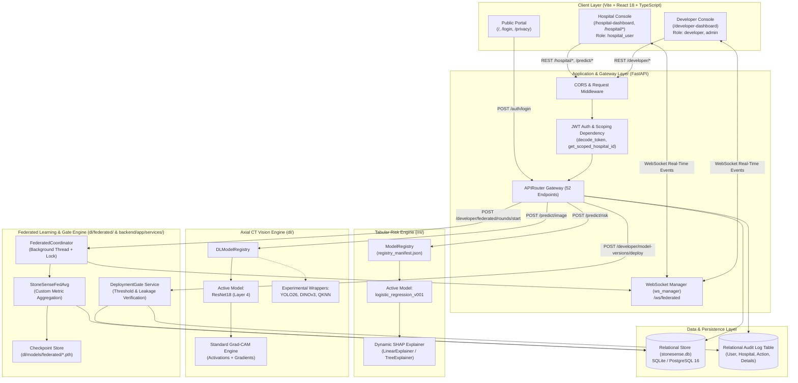

# StoneSense-AI System Architecture

**Document Version:** 2.0 (Verified Runtime Architecture)  
**Date:** October 2026  
**System Classification:** Explainable AI & Federated Decision-Support Research Platform  

---

## 1. Architectural Philosophy & Design Principles

StoneSense-AI is built on three foundational architectural principles:
1. **Decoupled Multi-Modal Evidence Streams**: Clinical urine biomarkers and axial CT scans are evaluated through completely separate, independent inference pipelines. There is **no synthetic early fusion** of modalities; clinicians evaluate both models' confidence and explainability independently.
2. **Zero Raw Patient Data Transfer (Federated Privacy)**: In the federated learning simulation, hospital nodes train exclusively on local partitions. Only model parameter matrices (NumPy weight tensors) are exchanged via Flower gRPC/WebSocket channels. Raw DICOM or JPEG image files never leave the simulated client boundary.
3. **Automated Governance & Deployment Gating**: No newly trained model checkpoint can be promoted to active clinician inference without passing a multi-metric automated deployment gate that verifies overall accuracy, recall thresholds on critical classes (`Stone`, `Tumor`), and regression tolerances against active models.

---

## 2. End-to-End System Architecture Diagram

---

## 3. Subsystem Breakdown

### 3.1 Presentation Tier (Frontend)
- **Framework**: React 18.3 with Vite 5.4 bundler and TypeScript 5.7.
- **Styling**: Tailwind CSS 3.4 with custom clinical palettes (`#F3F6F1` paper background, `#1F6F5C` clinical teal, and `#4F46E5` developer indigo).
- **Authentication Context**: [`AuthContext.tsx`](file:///c:/Users/akhil/projects/StoneSense-AI/frontend/src/context/AuthContext.tsx) manages JWT persistence, local storage tokens, role claims (`hospital_user`, `developer`, `admin`), and automated token refresh.
- **Hospital Scope Context**: [`HospitalContext.tsx`](file:///c:/Users/akhil/projects/StoneSense-AI/frontend/src/context/HospitalContext.tsx) synchronizes active hospital ID across the clinical console.

### 3.2 Gateway & API Tier (Backend)
- **Framework**: FastAPI 0.115+ running on Uvicorn ASGI server.
- **Entrypoint**: Factory function `create_app()` in [`backend/app/main.py`](file:///c:/Users/akhil/projects/StoneSense-AI/backend/app/main.py).
- **Security & Authorization**:
  - `get_current_user` extracts Bearer JWT token, validates claims and expiration, and fetches user row from DB.
  - `get_scoped_hospital_id` ensures clinical users can only query or insert records belonging to their assigned hospital (`hospital_id`), preventing cross-tenant leakage.
  - Rate limiting enforced on login endpoints using in-memory sliding window limiter.

### 3.3 Relational Database Schema (`stonesense.db`)
Mapped using SQLAlchemy 2.0 declarative models in [`backend/app/db/models.py`](file:///c:/Users/akhil/projects/StoneSense-AI/backend/app/db/models.py):

| Table | Purpose | Key Attributes |
| :--- | :--- | :--- |
| `hospitals` | Tenant hospital registry | `id`, `hospital_code`, `name`, `current_model_version`, `dataset_size` |
| `users` | User credentials & roles | `id`, `email`, `password_hash`, `role`, `hospital_id`, `is_active` |
| `patients` | Patient clinical files (AES-256-GCM encrypted PII at rest) | `id`, `hospital_id`, `reference_code`, `name` *(encrypted)*, `phone` *(encrypted)*, `email` *(encrypted)*, `name_bidx`, `phone_bidx`, `email_bidx`, `urine_features`, `admitted_date` |
| `predictions` | Clinical predictions history | `id`, `hospital_id`, `patient_id`, `prediction_type`, `model_name`, `confidence` |
| `federated_rounds` | Global FL round telemetry | `round_number`, `global_accuracy`, `global_f1`, `global_loss`, `status` |
| `hospital_training_runs` | Per-hospital FL round metrics | `hospital_id`, `round_number`, `local_loss`, `local_accuracy`, `sample_count` |
| `model_versions` | Versioned models registry | `version_tag`, `model_family`, `accuracy`, `f1_score`, `is_deployed`, `gate_report` |
| `audit_logs` | Standard relational audit log (No PII) | `id`, `action`, `resource_type`, `resource_id`, `hospital_id`, `user_id`, `user_email`, `details`, `created_at` |
| `inference_logs` | Operational inference logs | `model_name`, `version_tag`, `confidence`, `latency_ms`, `timestamp` |
| `drift_records` | Data drift monitoring records | `metric_name`, `p_value`, `drift_detected`, `snapshot_date` |

### 3.4 Machine Learning Engine (Tabular Biomarkers)
- **Directory**: `ml/`
- **Data Source**: 79 cleaned observations with 6 urinary biomarkers (`gravity`, `ph`, `osmo`, `cond`, `urea`, `calc`).
- **Optimization**: 50-fold nested repeated stratified cross-validation (`StratifiedKFold(5)` $\times$ 10 repeats) executing hyperparameter search via `GridSearchCV`.
- **Selection**: 1-Standard-Error rule selects the simplest model within 1 SE of top performance. Logistic Regression v001 ($ROC\text{-}AUC = 0.8387$) is active.
- **Explainability**: [`ml/explainability/shap_explainer.py`](file:///c:/Users/akhil/projects/StoneSense-AI/ml/explainability/shap_explainer.py) dynamically inspects estimator attributes: uses `shap.LinearExplainer` for linear models and `shap.TreeExplainer` for tree ensembles.

### 3.5 Deep Learning Vision Engine (Axial CT Slices)
- **Directory**: `dl/`
- **Architecture**: ResNet18 convolutional neural network initialized with Torchvision ImageNet-1K pretrained weights. The final fully connected layer is adapted to 4 classes (`Cyst`, `Normal`, `Stone`, `Tumor`).
- **Split Protocol**: Perceptual cluster grouping ($pHash \le 2$ Hamming distance) on 12,446 slices prevents patient/slice leakage across train (8,708), validation (1,869), and test (1,869) partitions.
- **Explainability**: Standard Grad-CAM hooks capture forward activations and backward gradients from `model.layer4[-1]`, computing spatial weights via global average pooling and generating jet colormap overlays.

### 3.6 Federated Learning & Deployment Gate Engine
- **Decentralized Coordination**: Flower (`flwr`) framework using custom strategy [`StoneSenseFedAvg`](file:///c:/Users/akhil/projects/StoneSense-AI/dl/federated/strategy.py).
- **Weight Aggregation**: Parameters are extracted via `get_model_parameters` as NumPy float tensors, aggregated according to client sample count weights, and pushed back into the global model.
- **Deployment Gate Pipeline**:
  - Validates candidate metrics against production thresholds: Accuracy $\ge 95\%$, Macro F1 $\ge 94\%$, Stone Recall $\ge 96\%$, Tumor Recall $\ge 98\%$.
  - Enforces regression limit: Candidate cannot regress more than 2% relative to currently deployed active model.
  - Rejects unverified/leaky data: Checkpoints marked with `trained_on_leaky_partitions = True` are blocked from promotion.

### 3.7 Multi-Stream Evidence Concordance Engine
- **Service**: [`backend/app/services/concordance_service.py`](file:///c:/Users/akhil/projects/StoneSense-AI/backend/app/services/concordance_service.py)
- **API**: `POST /api/v1/predict/concordance`
- **Frontend Component**: [`ConcordanceCard.tsx`](file:///c:/Users/akhil/projects/StoneSense-AI/frontend/src/components/ConcordanceCard.tsx)
- **Design**: Pure, deterministic evaluation without randomness or I/O. Supports resolving server-stored predictions by ID (`risk_prediction_id`, `image_prediction_id`, `patient_id`) with strict hospital tenant isolation. Compares independent outputs from tabular risk and CT imaging streams without synthetic data fusion.
- **Rule Precedence Order**:
  1. `RULE_1_INSUFFICIENT_DATA`: Missing or malformed inputs in either stream.
  2. `RULE_2_NON_STONE_FINDING`: Incidental CT finding (`Cyst` or `Tumor`). Highest clinical priority: always escalates to clinician review and can never be softened by low tabular risk.
  3. `RULE_3_LOW_CONFIDENCE`: Either stream below confidence threshold (0.60) or CT gate status flagged as review/OOD (`INCONCLUSIVE_OOD`).
  4. `RULE_4_CONCORDANT_STONE_EVIDENCE`: Elevated tabular risk ($\ge 0.50$) AND CT predicts `Stone` (`CONCORDANT_STONE`).
  5. `RULE_5_CONCORDANT_NO_STONE_EVIDENCE`: Low tabular risk ($< 0.50$) AND CT predicts `Normal` (`CONCORDANT_NO_STONE_EVIDENCE`). Label: "No stone evidence in either stream". Explicitly warns: NOT a clinical clearance; cites audited CT slice Stone recall (65.70%) and tabular sample limits ($N=79$).
  6. `RULE_6_DISCORDANT_EVIDENCE`: Streams point in opposing directions (`DISCORDANT_CT_POSITIVE` or `DISCORDANT_BIOMARKER_POSITIVE`).
- **Regulatory Notice**: Mandatory disclaimer returned in all payloads noting that models were trained on separate, unpaired patient cohorts and constitute decision support rather than diagnosis.

### 3.8 CT Upload Security Hardening & OOD Heuristic Gate
- **Module**: [`backend/app/utils/image_utils.py`](file:///c:/Users/akhil/projects/StoneSense-AI/backend/app/utils/image_utils.py)
- **API**: `POST /api/v1/predict/image`
- **Payload Controls**:
  - Ingress proxy limit: Nginx `client_max_body_size 10M;`
  - Bounded 64 KB chunk reading with early termination at 10 MB (HTTP 413).
  - True file signature verification via magic bytes: PNG and JPEG accepted; all others rejected (HTTP 415).
  - Decompression bomb protection: Scoped Pillow `DecompressionBombWarning` promoted to error with explicit `width * height > MAX_IMAGE_PIXELS` (60 MP default) check, restoring global settings in `finally` block (HTTP 413).
  - Integrity and dimension checks: Corrupt images and slices below 32x32 rejected (HTTP 422).
  - Aspect ratio check: Non-axial ratios ($> 10.0:1$) rejected (HTTP 422).
  - Sanity check: Near-constant image variance check ($\sigma < 2.0$, warning in response).
- **OOD Uncertainty Gate**: Evaluates maximum softmax probability and Shannon predictive entropy. When top class confidence $< 0.45$ or entropy $> 1.30$ nats, response returns `status = "needs_review"` and `class_name = "needs_review"` with full probability distribution. Heuristic note: deep networks can yield high confidence on Gaussian noise textures; the gate does not guarantee that accepted images are genuine kidney CT scans.

